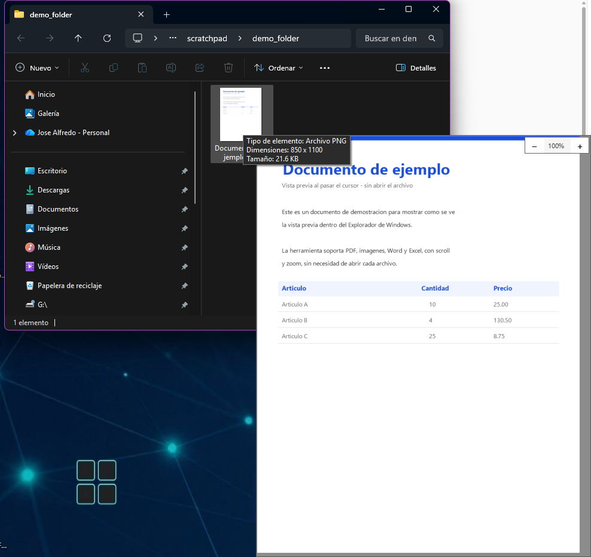

<div align="center">


# Vista Previa (hover) para el Explorador de Windows

**Muestra una vista previa del archivo con solo pasar el cursor por encima, sin abrirlo.**
PDF · Imágenes · Word · Excel · PowerPoint · Texto · ZIP · Correos — con scroll y zoom.

*Hover preview for Windows Explorer: preview PDF, images, Word and Excel files just by hovering — no need to open them.*

</div>

---



## ✨ Qué hace

Pasas el cursor sobre un archivo en el Explorador de Windows, esperas medio segundo
y aparece una vista previa flotante — sin abrir el archivo ni cargar programas pesados.

- 📄 **PDF** — todas las páginas, con scroll
- 🖼️ **Imágenes** — JPG, PNG, GIF, BMP, TIFF, ICO y **HEIC/WebP** (fotos de celular)
- 📝 **Word** — .doc, .docx, .rtf
- 📊 **Excel** — .xls, .xlsx
- 📽️ **PowerPoint** — .ppt, .pptx
- 📂 **OpenDocument** — .odt, .ods, .odp (OpenOffice/LibreOffice, vía MS Office)
- 📃 **Texto y código** — .txt, .csv, .log, .xml, .json, .cs, .js, .html, etc.
- 📝 **Markdown** — .md con formato (títulos, negrita, listas, código)
- 🗜️ **ZIP** — lista el contenido sin descomprimir
- 📧 **Correos** — .eml (y .msg si tienes Outlook)
- 🎞️ **Videos** — .mp4, .mov, .avi, .wmv… (muestra el primer cuadro)
- 🔍 **Zoom** — Ctrl + rueda, o los botones  −  / ＋  (recuerda el nivel que elijas)
- 🖱️ **Scroll** — rueda del mouse (Shift + rueda = horizontal)
- 🔘 **Botón "Abrir"** — abre el archivo con un clic si es el que buscabas
- 📋 **Botón "Copiar"** — copia el texto (en modo texto/código/correo)
- 📌 **Fijar** — deja la vista previa abierta para leerla con calma (y puedes moverla)
- ↔️ **Ventana redimensionable** — estira los bordes; recuerda el tamaño
- 🌙 **Tema claro/oscuro** — sigue automáticamente al de Windows
- ⏱️ **Tiempo de aparición** ajustable desde el menú de la bandeja
- 🗂️ Funciona también en los **cuadros de diálogo "Abrir / Guardar"** de otros
  programas (útil para ver qué archivo vas a adjuntar antes de elegirlo).
- 🧰 Vive en la **bandeja del sistema** (ícono de lupa azul) con opciones de
  Pausar, Iniciar con Windows, Tiempo de aparición y Salir.

## 💡 Por qué

A veces solo quieres *echar un vistazo* a un archivo antes de abrirlo. Abrir PDFs,
Word o Excel toma tiempo; esta herramienta te deja ver el contenido al instante,
igual que la miniatura pero mostrando el documento completo y navegable.

## 🖥️ Requisitos

- **Windows 10 u 11** (usa el motor de PDF que ya trae Windows).
- **Microsoft Office** instalado, solo para previsualizar **Word y Excel**
  (PDF e imágenes no lo necesitan).

## 🚀 Instalación / uso rápido

1. Descarga el programa (ver [Releases](../../releases)) o compílalo tú mismo (abajo).
2. Doble clic en `VistaPreviaPDF.exe`. Queda corriendo en la bandeja del sistema.
3. Pasa el cursor sobre un PDF, imagen, Word o Excel en el Explorador.

> La primera vez Windows puede mostrar **SmartScreen** ("Windows protegió tu PC"),
> porque es un programa nuevo sin certificado de una autoridad comercial.
> Haz clic en **"Más información" → "Ejecutar de todos modos"**.
> Solo lee archivos localmente; **no se conecta a internet ni envía datos**.

### Que inicie con Windows

Clic derecho en el ícono de la bandeja (la lupa azul) → **"Iniciar con Windows"**.
Crea un acceso directo en tu carpeta de Inicio. Clic otra vez para quitarlo.

## 🛠️ Compilar desde el código

No necesitas descargar nada: se compila con el C# que ya trae .NET Framework.

```powershell
# Desde PowerShell, en la carpeta del proyecto:
./VistaPreviaPDF/build.ps1
```

El script usa `csc.exe` (de `C:\Windows\Microsoft.NET\Framework64\v4.0.30319`)
y referencia los WinMetadata (`Windows.Data.winmd`, etc.) para el motor de PDF.
Genera `VistaPreviaPDF.exe`.

## 🧩 Cómo funciona (técnico)

- **Tray app** en WinForms (`NotifyIcon`), ventana de vista previa sin bordes y
  *no-activable* (no roba el foco).
- **PDF**: `Windows.Data.Pdf` (WinRT nativo). El PDF se carga **a memoria**
  (`LoadFromStreamAsync`) para no bloquear el archivo mientras se previsualiza.
- **Detección del archivo bajo el cursor**: UI Automation (`AutomationElement.FromPoint`)
  + `Shell.Application` para resolver la ruta.
- **Scroll/zoom**: hook de mouse de bajo nivel (`WH_MOUSE_LL`) sin robar el foco.
- **Word/Excel**: se convierten a PDF vía automatización COM de Office y se cachean.

## ⚠️ Nota sobre antivirus

Es un ejecutable casero. Algunos antivirus corporativos pueden marcarlo por
heurística (sobre todo si se auto-instala o escribe en el registro — por eso esta
versión **no hace** ninguna de esas dos cosas). Para uso en redes empresariales,
lo ideal es firmarlo y que el área de IT lo apruebe.

## 📜 Licencia

[MIT](LICENSE) — úsalo, modifícalo y compártelo libremente.
